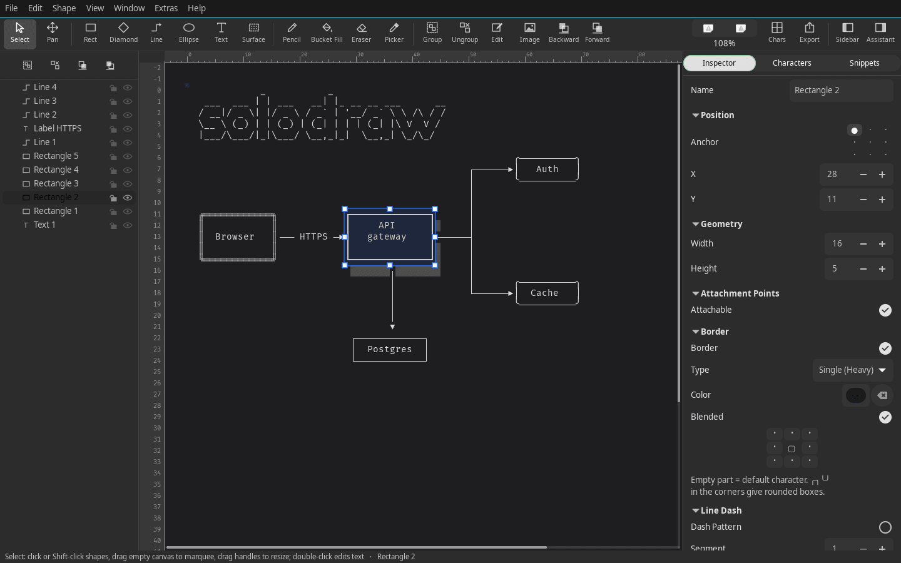
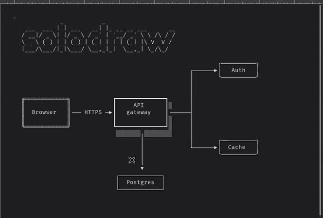
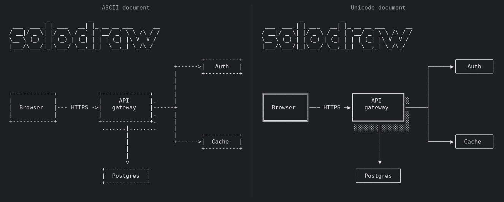

# solodraw

An ASCII/Unicode diagram editor for Linux that opens, edits and saves `.monopic` files, the document
format of [Monodraw](https://monodraw.helftone.com/) for macOS. Draw boxes, connectors, text, FIGlet
banners and free-hand art on a character grid; export as plain text, PNG or SVG.



> solodraw is an independent project. It is not affiliated with, endorsed by or connected to
> Helftone or Monodraw. "Monodraw" is a trademark of its owner and is used here only to describe
> file compatibility. If you're on a Mac, buy Monodraw.

* `crates/core`: document model, `.monopic`/`.monojson` load and save (including every legacy model
  version), renderer and text export. Written from [`SPEC.md`](SPEC.md), a description of the file
  format and of Monodraw's observable behaviour.
* `crates/cli`: `solodraw`, a command-line renderer with the same options as Monodraw's bundled CLI.
* `crates/gui`: `solodraw-gtk`, a GTK4 editor.

## Building

Needs Rust (stable) and the GTK 4.6+ development files for the editor.

```sh
# Debian / Ubuntu / Pop!_OS 22.04+
sudo apt install build-essential libgtk-4-dev
# Fedora
sudo dnf install gtk4-devel
# Arch
sudo pacman -S gtk4

cargo build --release
cargo test
```

The binaries land in `target/release/` (`solodraw`, `solodraw-gtk`, `solodraw-mcp`). The CLI, the MCP server and
`crates/core` have no GTK dependency: `cargo build --release -p solodraw-cli -p solodraw-mcp` builds without the
GTK headers.

## Use

```sh
solodraw [--unicode|--no-unicode] [--trim-whitespace] [--trim-padding] [--skip-newline] [--json] file.monopic
solodraw-gtk [file.monopic]
```

Editor keys: **S** select · **R** rectangle · **D** diamond · **C** ellipse · **L** line (drag between boxes to
connect) · **T** text · **F** surface · **B** bucket fill · **E** eraser · **I** character picker · **P** pencil (click a box, type free-hand characters) · **Del** delete · arrows nudge (Shift = ×8) ·
**Enter**/double-click edit text · **Ctrl+C / Ctrl+X / Ctrl+V** copy, cut, paste shapes (other apps get
the text; pasted text becomes a Surface, **Ctrl+Shift+V** forces that) · **Ctrl+D** duplicate · **Ctrl+G /
Ctrl+Shift+G** group/ungroup · **Ctrl+Shift+\\** flatten · **Ctrl+Alt+C / Ctrl+Alt+V** copy/paste style · **Ctrl+E** export (text with
comment styles / HTML / shell wrappers, PNG, SVG) · **Ctrl+,** preferences ·
**Ctrl+S / Ctrl+Shift+S / Ctrl+O** · **Ctrl+Z / Ctrl+Shift+Z** · **G** grid · **Ctrl±** / Ctrl+scroll zoom.
Click selects a top-level shape (a whole card); click again or Shift-click to reach a shape inside a group.

Connectors stay attached and reroute as you move shapes:



The same drawing as an ASCII document and as a Unicode one:



FIGlet banners need `.flf` fonts, which are not bundled. The standard fonts in `/usr/share/figlet`
(`sudo apt install figlet`) are found automatically; put others in `~/.local/share/solodraw/figlet-fonts/`
or point `SOLODRAW_FIGLET_DIR` at a directory.

## Drawing with an AI (MCP)

`solodraw-mcp` is a [Model Context Protocol](https://modelcontextprotocol.io) server over stdio. It lets an
AI assistant build and edit `.monopic` files without the editor. It can add boxes, text, FIGlet lettering,
character art, ellipses, diamonds, connectors and free lines; move, restyle, group, duplicate and delete
shapes; undo; and save. Its `render` tool returns the drawing as text with numbered rows and columns, so the
assistant can check its own work after each step.

```sh
# Claude Code
claude mcp add -s user solodraw -- solodraw-mcp
# any MCP client: run `solodraw-mcp [--autosave] [file.monopic]` as a stdio server
```

Shapes can be referred to by id or by the `name` given when they were created. The same commands are
available to Rust code through `solodraw_core::command::Session::exec`.

## Status

Usable for everyday diagrams. Reads every `.monopic` model version Monodraw has written; saving and
reloading a document leaves its rendering unchanged.

Conformance is measured against Monodraw 1.6.1's own exports, compared byte for byte:

| Suite | Result |
|---|---|
| Diagram line router, 8 layouts × 16 attachment-side pairs (`fixtures/gui/01-diagram-router`) | 128 / 128 |
| Ellipse rasterisation, 324 sizes × 2 border styles (`fixtures/gui/02-ellipse-thinning`) | 105 / 107 documents |
| ER crow's-foot heads × notations (`fixtures/gui/03-er-crowsfoot`) | 18 / 18 |
| Bundled-CLI text export of 45 real-world documents, ASCII and Unicode | 90 / 90 (private fixtures, see below) |

### Known gaps

* **Ellipses:** the 13-row × 16-column ellipse differs by one cell (and its mirror), in both border styles.
* **Image shapes:** loaded, saved and shown as tracing overlays; not rendered into exports.
* **Table tool:** implemented but opt-in (Window ▸ Developer ▸ Table Shape), as in Monodraw; no
  golden captures yet.
* **Untested line types:** Step and Staggered lines and Automatic lines with several ends render, but
  have no golden captures to check them against.

## Tests and fixtures

`cargo test` runs everything in the repository. The test drawings under `fixtures/gui/` were made for
testing in Monodraw's GUI and exported with its default settings; each step's `NOTES.md` says how.

Some tests use files that aren't in the repository and skip without them:

* `SOLODRAW_PRIVATE_FIXTURES` (default `fixtures/private/`): real-world documents and Monodraw's
  exports of them (`monopic/`, `cli-golden/`, `ASCII_CG_Layout.txt`).
* `SOLODRAW_MONODRAW_RESOURCES` (default `/Applications/Monodraw.app/Contents/Resources`): Monodraw's
  bundled intro document and snippets, from your own install.

## License

MIT. See [LICENSE](LICENSE).
